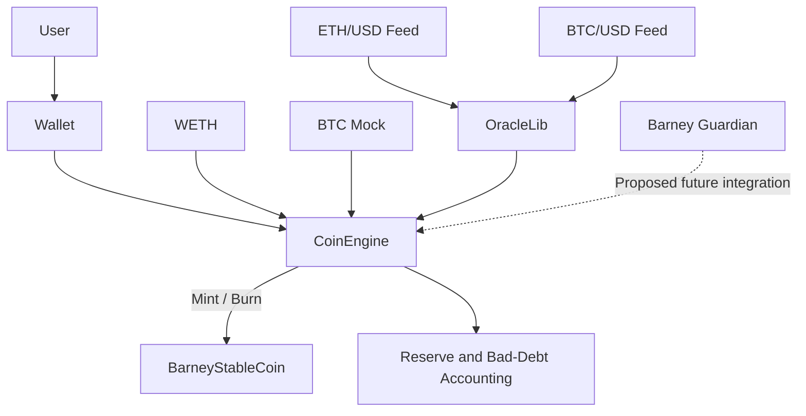

# Barney StableCoin — Overcollateralized Stablecoin Protocol

[](https://soliditylang.org/)
[](https://book.getfoundry.sh/)
[](https://chain.link/)
[](https://sepolia.etherscan.io/)
[](#running-tests)

> **Testnet engineering project:** An overcollateralized, USD-pegged stablecoin protocol featuring multi-asset collateral, Chainlink price feeds, automated liquidation, reserve management and explicit bad-debt accounting.

Barney StableCoin (BSC) is a decentralized stablecoin protocol built with Solidity and Foundry. It enables users to mint a USD-pegged ERC-20 token against supported crypto collateral while enforcing collateralization requirements and debt accounting on-chain.

The protocol consists of BarneyStableCoin, CoinEngine and OracleLib, with a future governance and protocol safety vision through **Barney Guardian**.

**Network:** Ethereum Sepolia Testnet

**Stablecoin:** BarneyStableCoin (BSC)

**CoinEngine:** [View on Sepolia Etherscan](https://sepolia.etherscan.io/address/0x515f8eED4344B28458D69899217A51F9c495701d)

📄 **Technical Whitepaper:** [Barney StableCoin — Technical Whitepaper v1.0 (PDF)](docs/whitepaper/Barney_StableCoin_Technical_Whitepaper_Polished.pdf)

---

## Table of Contents

- [Overview](#overview)
- [Why It Matters](#why-it-matters)
- [At a Glance](#at-a-glance)
- [Non-Production Scope](#non-production-scope)
- [Architecture](#architecture)
- [Core Components](#core-components)
- [Functional Scope](#functional-scope)
- [Protocol Lifecycle](#protocol-lifecycle)
- [Core Financial Flows](#core-financial-flows)
- [Liquidation and Risk Management](#liquidation-and-risk-management)
- [Reserve and Bad-Debt Accounting](#reserve-and-bad-debt-accounting)
- [Oracle Integration and Price Safety](#oracle-integration-and-price-safety)
- [Security Model](#security-model)
- [Protocol Invariants](#protocol-invariants)
- [Getting Started](#getting-started)
- [Running Tests](#running-tests)
- [Deployment](#deployment)
- [Sepolia Deployment](#sepolia-deployment)
- [Barney Guardian](#barney-guardian)
- [Limitations and Roadmap](#limitations-and-roadmap)
- [Production Hardening Checklist](#production-hardening-checklist)
- [Repository Structure](#repository-structure)
- [References](#references)
- [License](#license)

---

## Overview

Barney StableCoin implements an overcollateralized stablecoin system centered around an ERC-20 token and a dedicated collateral management engine.

The protocol focuses on:

- Multi-asset crypto collateral.
- USD-denominated collateral valuation.
- Chainlink price-feed integration.
- Collateralized BSC issuance and repayment.
- Health-factor enforcement.
- Automated liquidation mechanisms.
- Protocol reserve accounting.
- Explicit bad-debt recognition.
- Stateful fuzz and invariant testing.

### Why It Matters

Stablecoin protocols must maintain consistency between collateral, outstanding debt, token supply and liquidation mechanisms.

This project explores three important engineering concerns:

1. **Collateral solvency:** How does the protocol ensure issued stablecoins are adequately collateralized?
2. **Risk enforcement:** How are unhealthy positions identified and liquidated?
3. **Accounting integrity:** How are reserves and unrecovered debt tracked without silently losing accounting consistency?

The objective is to demonstrate collateralized stablecoin architecture, oracle integration, liquidation engineering and rigorous smart-contract testing.

## At a Glance

| Parameter | Configuration |
|---|---|
| Stablecoin | BarneyStableCoin (BSC) |
| Token standard | ERC-20 |
| Accounting currency | USD |
| Collateral | WETH and BTC-like mock |
| Oracle | Chainlink Price Feeds |
| Liquidation threshold | 55% |
| Liquidation bonus | 10% |
| Network | Ethereum Sepolia |
| Chain ID | 11155111 |
| Solidity | 0.8.33 |
| Framework | Foundry |
| Recorded tests | 112 passed |
| Invariant campaign | 256 runs, 32,768 handler calls |

These are the documented project configuration and recorded test results. The deployed contracts and their stored configuration are authoritative for the Sepolia instance.

## Non-Production Scope

Barney StableCoin is an experimental testnet engineering project, not an independently audited financial protocol.

Current scope:

- Ethereum Sepolia deployment.
- WETH and eight-decimal BTC-like mock collateral.
- Chainlink USD price-feed configuration.
- Collateralized issuance and repayment.
- Liquidation and redemption mechanisms.
- Reserve and bad-debt accounting.
- No integrated Barney Guardian governance.
- No production mainnet deployment.

The BTC-like token is a test ERC-20 mock. It is not canonical WBTC and is not backed by Bitcoin.

## Architecture

The protocol separates token issuance, collateral management and oracle operations.



### Architecture Boundaries

- **BarneyStableCoin:** ERC-20 token issued and burned under CoinEngine authority.
- **CoinEngine:** Enforces collateral, debt, health-factor, liquidation and accounting rules.
- **OracleLib:** Provides Chainlink price-feed reading and validation functionality.
- **Chainlink:** Supplies external collateral price observations.
- **Barney Guardian:** Proposed future governance and protocol safety layer; not currently integrated.

The smart contracts are authoritative for collateral balances, debt and protocol state.

## Core Components

### BarneyStableCoin.sol

The protocol's ERC-20 stablecoin.

Responsibilities:

- ERC-20 token implementation.
- Controlled minting and burning.
- Ownership-based issuance authority.
- Integration with CoinEngine.

### CoinEngine.sol

The core collateral and debt management contract.

Responsibilities:

- Collateral deposits and redemption.
- BSC minting and repayment.
- USD collateral valuation.
- Health-factor calculations.
- Liquidation execution.
- Reserve accounting.
- Bad-debt recognition.

### OracleLib.sol

The Chainlink oracle integration library.

Responsibilities:

- Reading Chainlink price feeds.
- Oracle response validation.
- Price decimal normalization.
- Collateral valuation support.

### HelperConfig.s.sol

Provides network-specific deployment configuration, including collateral token addresses and their corresponding price feeds.

### DeployBSC.s.sol

Deploys the protocol contracts and establishes CoinEngine as the stablecoin's issuance authority.

## Functional Scope

| Capability | Description |
|---|---|
| Collateral deposits | Accepts supported ERC-20 collateral |
| Stablecoin issuance | Mints BSC against eligible collateral |
| Debt repayment | Burns BSC and reduces outstanding debt |
| Collateral redemption | Withdraws eligible collateral |
| USD valuation | Uses Chainlink price feeds |
| Health factor | Evaluates collateralization risk |
| Liquidation | Recovers collateral against eligible debt |
| Reserve accounting | Tracks protocol-owned collateral |
| Bad-debt recognition | Records unrecovered debt |
| Accounting views | Exposes collateral, debt and reserve data |

## Protocol Lifecycle

The protocol follows a collateralized issuance lifecycle.

1. **Deposit:** Users deposit supported collateral into CoinEngine.
2. **Valuation:** Collateral is valued using configured Chainlink USD feeds.
3. **Mint:** Eligible users mint BSC against their collateral positions.
4. **Repayment:** Users repay outstanding debt by burning BSC.
5. **Redemption:** Eligible collateral can be withdrawn subject to risk constraints.
6. **Liquidation:** Unhealthy positions can be liquidated to recover outstanding debt.
7. **Accounting:** Reserves and recognized bad debt are maintained separately.

## Core Financial Flows

### Collateral Deposit and Valuation

Users deposit supported ERC-20 assets into CoinEngine.

The engine records collateral balances and obtains USD-denominated values through OracleLib.

The protocol accounts for different token decimal configurations:

- WETH: 18 decimals.
- BTC mock: 8 decimals.

### Stablecoin Minting

Users request BSC issuance against deposited collateral.

CoinEngine:

1. Retrieves the user's collateral balances.
2. Calculates total collateral value.
3. Evaluates outstanding debt.
4. Calculates the resulting health factor.
5. Enforces applicable collateralization constraints.
6. Mints BSC when the position satisfies protocol requirements.

### Repayment and Burning

Users repay outstanding BSC debt through CoinEngine.

The repayment mechanism burns BSC and updates outstanding debt and recognized bad-debt accounting.

Repayment is supported even when an account is underwater.

### Collateral Redemption

Users can redeem eligible collateral when the resulting position satisfies the protocol's applicable risk constraints.

The engine maintains accounting consistency across user collateral and protocol reserves.

## Liquidation and Risk Management

The protocol uses a health-factor mechanism to evaluate collateralized positions.

Conceptually:

```text
Health Factor = Adjusted Collateral Value / Outstanding Debt
```

Positions crossing the configured liquidation boundary become eligible for liquidation.

| Parameter | Value |
|---|---:|
| Liquidation threshold | 55% |
| Liquidation bonus | 10% |

Liquidation allows eligible participants to repay outstanding debt in exchange for collateral and an incentive.

The mechanism is designed to reduce protocol exposure to undercollateralized positions.

## Reserve and Bad-Debt Accounting

The protocol distinguishes between:

- User collateral.
- Protocol-owned reserve collateral.
- Outstanding debt.
- Recognized bad debt.

When collateral is exhausted and debt remains unrecovered, the engine records the residual amount as recognized bad debt.

Reserve balances and bad-debt records are tracked separately.

The configured treasury/bad-debt sink is not a governance mechanism and is not Barney Guardian.

## Oracle Integration and Price Safety

The protocol uses Chainlink AggregatorV3 price feeds for collateral valuation.

### Sepolia Price Feeds

| Feed | Address |
|---|---|
| ETH/USD | `0x694AA1769357215DE4FAC081bf1f309aDC325306` |
| BTC/USD | `0x1b44F3514812d835EB1BDB0acB33d3fA3351Ee43` |

Oracle data is a critical dependency because collateral valuation directly influences issuance and liquidation decisions.

Oracle validation must account for invalid responses, stale observations, decimal differences and feed configuration.

Reference: [Chainlink Data Feeds Documentation](https://docs.chain.link/data-feeds)

## Security Model

The protocol incorporates several security-conscious design mechanisms.

| Risk | Current Control |
|---|---|
| Unauthorized token issuance | CoinEngine-controlled ownership |
| Reentrancy | Reentrancy protection on relevant entry points |
| Invalid collateral | Configured collateral support |
| Incorrect valuation | Chainlink price-feed integration |
| Decimal mismatch | Token decimal-aware valuation |
| Undercollateralized debt | Health-factor enforcement |
| Unrecoverable debt | Explicit bad-debt accounting |
| Accounting inconsistency | Stateful invariant testing |

### Security Assumptions

The protocol remains dependent on:

- Correct collateral and oracle configuration.
- Chainlink feed availability and correctness.
- Market liquidity for liquidation.
- Correct execution of collateral and debt transitions.
- Secure deployment and administrative key management.

No independent third-party security audit or formal verification certification is claimed.

## Protocol Invariants

The invariant suite evaluates important accounting properties:

- Physical collateral held by CoinEngine reconciles with user collateral and protocol reserves.
- Public getters remain callable.
- BSC total supply reconciles with outstanding debt across tracked handler actors.
- Aggregate recognized bad debt reconciles with tracked user-level bad debt.
- Recognized bad debt does not exceed tracked outstanding debt.

### Recorded Invariant Campaign

- 256 runs.
- 32,768 handler calls.
- Zero handler reverts.

These properties are bounded by the invariant handler, tracked actors and generated actions. They are not a universal proof of correctness.

## Getting Started

### Prerequisites

- [Git](https://git-scm.com/)
- [Foundry](https://book.getfoundry.sh/getting-started/installation)
- [Solidity](https://soliditylang.org/)
- An Ethereum RPC endpoint for fork testing and deployment.

### Installation

```bash
git clone https://github.com/barnabasmunuhe/Barney-StableCoin.git

cd Barney-StableCoin

forge install
```

### Build

```bash
forge build
```

### Run Tests

```bash
forge test -vvv
```

### Format

```bash
forge fmt
```

## Running Tests

The project uses Foundry for automated smart-contract testing.

### Testing Strategy

| Test Layer | Purpose |
|---|---|
| Unit testing | Validates contract functions, access control and accounting |
| Fuzz testing | Explores generated inputs and edge cases |
| Invariant testing | Evaluates accounting properties across generated action sequences |
| Fork testing | Exercises integration behavior against Sepolia state |

### Recorded Test Results

| Test Category | Result |
|---|---:|
| BarneyStableCoin unit tests | 14 |
| CoinEngine unit tests | 76 |
| OracleLib tests | 7 |
| Fuzz tests | 8 |
| Sepolia fork tests | 6 |
| Invariant properties | 5 |
| **Total** | **112 passed** |

Recorded execution:

- 112 passed.
- 0 failed.
- 0 skipped.
- 256 invariant runs.
- 32,768 handler calls.

Fork tests require a valid Sepolia RPC endpoint.

## Deployment

The documented deployment is on Ethereum Sepolia.

### Environment Variables

Configure your `.env` file:

```bash
SEPOLIA_RPC_URL=
```

Use the configured Foundry deployment account and sender.

### Deployment Command

```bash
source .env

forge script script/DeployBSC.s.sol \
  --rpc-url "$SEPOLIA_RPC_URL" \
  --account metamask-dev \
  --sender "$DEPLOYER" \
  --broadcast
```

Never commit private keys, RPC credentials or other secrets to the repository.

## Sepolia Deployment

**Network:** Ethereum Sepolia  
**Chain ID:** 11155111  
**Deployment Date:** 23 November 2026

### Deployed Contracts

| Contract | Address |
|---|---|
| BarneyStableCoin | `0xE028Ef489795CEE98DA4d66f97879bB3FcA55E64` |
| CoinEngine | `0x515f8eED4344B28458D69899217A51F9c495701d` |
| OracleLib | `0x3eD73A71300b5e1796551307cb618E2ff796a244` |

### Collateral Tokens

| Asset | Address |
|---|---|
| WETH | `0xdd13E55209Fd76AfE204dBda4007C227904f0a81` |
| BTC mock | `0x929Aae401dF8e284Cec97d099999C6d1d977A35D` |

### Treasury / Bad-Debt Sink

```text
0x8fEf6247BF77b91E4982757aCdB08610605388f7
```

### Deployment Verification

Post-deployment read-only calls confirmed:

- Contract bytecode exists at all three deployed contract addresses.
- CoinEngine owns BarneyStableCoin.
- Configured collateral tokens and price feeds.
- Configured bad-debt sink.
- BSC name, symbol and initial total supply.
- WETH and BTC mock decimal configurations.

[View CoinEngine on Sepolia Etherscan](https://sepolia.etherscan.io/address/0x515f8eED4344B28458D69899217A51F9c495701d)

[View BarneyStableCoin on Sepolia Etherscan](https://sepolia.etherscan.io/address/0xE028Ef489795CEE98DA4d66f97879bB3FcA55E64)

[View OracleLib on Sepolia Etherscan](https://sepolia.etherscan.io/address/0x3eD73A71300b5e1796551307cb618E2ff796a244)

Deployment verification confirms selected contract and configuration properties. It does not establish that every live transaction lifecycle has been validated.

## Barney Guardian

Barney Guardian is a proposed complementary protocol within the Barney ecosystem.

Its planned architecture explores:

- Decentralized governance.
- A staking-based Safety Module inspired by Aave.
- Protocol risk oversight.
- Governance-authorized bad-debt settlement.
- Additional protocol resilience mechanisms.

**Integration status: Not currently implemented.**

CoinEngine does not currently communicate with Barney Guardian, and Guardian does not authorize or execute BSC bad-debt settlements.

This remains a future development objective.

## Limitations and Roadmap

### Current Limitations

- Sepolia testnet deployment only.
- BTC-like collateral is a test mock, not canonical WBTC.
- Complete manual Sepolia lifecycle validation remains outstanding.
- No independent security audit.
- No formal verification.
- Liquidation effectiveness depends on external market liquidity.
- Barney Guardian is not integrated.
- No production mainnet deployment.

### Potential Future Improvements

- Complete live Sepolia lifecycle validation.
- Expand stateful fuzzing and invariant coverage.
- Validate liquidation and bad-debt scenarios.
- Run Slither and Aderyn static analysis.
- Strengthen oracle and accounting regression tests.
- Design Barney Guardian governance and Safety Module.
- Implement and test governance-based settlement integration.
- Complete independent security review.

These are proposed improvements, not currently implemented features.

## Production Hardening Checklist

Before considering production deployment:

- [ ] Complete independent smart-contract security audit.
- [ ] Review ownership and key-management architecture.
- [ ] Evaluate multisig and governance controls.
- [ ] Validate all oracle failure scenarios.
- [ ] Complete manual Sepolia lifecycle testing.
- [ ] Expand fuzz and invariant testing.
- [ ] Run and triage Slither and Aderyn findings.
- [ ] Verify deployed source code and constructor arguments.
- [ ] Validate liquidation and bad-debt accounting.
- [ ] Implement operational monitoring and alerting.
- [ ] Design and test Barney Guardian integration.

## Repository Structure

```text
Barney-StableCoin/
│
├── src/
│   ├── BarneyStableCoin.sol
│   ├── CoinEngine.sol
│   └── libraries/
│       └── OracleLib.sol
│
├── script/
│   ├── DeployBSC.s.sol
│   └── HelperConfig.s.sol
│
├── test/
│   ├── unit/
│   ├── fuzz/
│   ├── invariant/
│   ├── fork/
│   └── mocks/
│
├── lib/
│
├── docs/
│   └── whitepaper/
│       └── Barney_StableCoin_Technical_Whitepaper_Polished.pdf
│
├── foundry.toml
├── foundry.lock
├── README.md
└── .gitignore
```

The directory tree represents the documented project organization; exact filenames may evolve with the repository.

## References

- [Solidity Documentation](https://docs.soliditylang.org/)
- [Foundry Documentation](https://book.getfoundry.sh/)
- [OpenZeppelin Contracts](https://docs.openzeppelin.com/contracts/)
- [Chainlink Data Feeds](https://docs.chain.link/data-feeds)
- [Chainlink AggregatorV3Interface](https://docs.chain.link/data-feeds/api-reference)
- [Ethereum Sepolia](https://sepolia.etherscan.io/)
- [Aave Protocol](https://aave.com/)
- [MakerDAO](https://makerdao.com/)

## License

MIT License.

---

**Barney StableCoin** — An engineering exploration of overcollateralized stablecoin infrastructure, oracle-driven valuation, liquidation mechanisms, reserve accounting and protocol resilience.

Built with Solidity, Foundry, Chainlink and OpenZeppelin.
